# Dental Data · logotipo y estilo

Instrucciones para quien edite esta web (personas, Claude Code o Copilot). GitHub Pages solo publica lo que hay en el repositorio: la marca vive en `assets/brand/`. **No redibujar el logo en el HTML: usar siempre estos archivos.**

## El logotipo
- **Símbolo:** una «D» maciza azul marino cuyo hueco tiene forma de muela; dentro de la muela, una estrella dorada.
- **Arco de estrellas:** 7 estrellas doradas en semicírculo a la izquierda de la D, copiadas del logotipo de Ullswater Investments (misma forma, mismo arco, misma separación). El arco ocupa la altura de la D; con la curva de la D forma un círculo, como la bandera europea.
- **Nombre:** «dental data» en minúsculas, Montserrat Bold (700). «dental» en azul marino (o blanco sobre oscuro); «data» siempre en dorado.
- **Lema (solo versión vertical):** «FEDERATED DENTAL DATA SPACE», Hanken Grotesk Bold, mayúsculas, espaciado 0,16 em.
- Los textos de los SVG están convertidos a trazos: no dependen de fuentes instaladas.

## Archivos
| Archivo | Uso |
|---|---|
| `dentaldata-logo-horizontal-white.svg` | Cabecera de la web y fondos oscuros |
| `dentaldata-logo-horizontal-color.svg` (+ `.png`) | Fondos claros, documentos, firmas de correo |
| `dentaldata-logo-vertical-white.svg` | Pie de página y portadas oscuras |
| `dentaldata-logo-vertical-color.svg` (+ `.png`) | Portadas claras, presentaciones, carteles |
| `dentaldata-symbol-color.svg` / `-white.svg` | Símbolo con estrellas, sin nombre |
| `favicon.svg`, `apple-touch-icon.png` | Pestaña del navegador y móvil (solo la D, sin arco: a ese tamaño no se ve) |
| `dentaldata-avatar.svg` / `-512.png` | LinkedIn, YouTube, redes |
| `og-dentaldata.png` | Imagen al compartir la web (1200×630) |
| `brand.css` | Colores, tipografías y escala de textos |

## Cómo ponerlo en una página
```html
<link rel="icon" href="/assets/brand/favicon.svg" type="image/svg+xml">
<link rel="apple-touch-icon" href="/assets/brand/apple-touch-icon.png">
<meta property="og:image" content="https://dentaldata.softwareinabox.eu/assets/brand/og-dentaldata.png">

<!-- Cabecera (fondo oscuro), altura 40 px -->
<a class="brand" href="/es/"></a>

<!-- Pie de página (fondo oscuro), 240 px de ancho -->

```
La relación con Microsoft va **fuera** del logo: texto «sobre Microsoft Azure» tras una línea vertical, o la insignia oficial de partner en otra zona. Nunca el logotipo de Microsoft pegado o dentro del de Dental Data.

## Reglas
- Espacio libre alrededor: como mínimo la altura de la estrella de la muela ×2.
- Tamaño mínimo: logo horizontal 32 px de alto; por debajo, usar el favicon.
- No cambiar colores, no estirar, no rotar, no añadir sombras ni contornos, no quitar ni mover estrellas.
- Sobre fotos, usar la versión blanca con una capa azul marino semitransparente debajo.

## Colores
| Nombre | Hex | Uso |
|---|---|---|
| Azul marino | `#0B2545` | D, títulos, fondos oscuros |
| Azul marino 2 | `#14335C` | Degradados y bloques secundarios |
| Oro | `#C9A227` | Estrellas, «data» y acentos sobre oscuro; botones con texto azul marino |
| Oro logo claro | `#A8841A` | «data» del logo vertical sobre blanco |
| Oro texto | `#8A6D0B` | Texto dorado pequeño, enlaces e iconos sobre blanco |
| Oro suave | `#EDBC6C` | Detalles finos sobre oscuro |
| Blanco | `#FFFFFF` | Fondos claros y textos sobre oscuro |
| Papel | `#F6F7FA` | Secciones claras alternas |
| Tinta / Gris | `#1E2633` / `#5B6573` | Texto normal / secundario |

La marca ya no usa verde petróleo: azul marino, blanco y oro.

## Estilo de texto
| Elemento | Tipografía | Peso | Tamaño |
|---|---|---|---|
| Títulos H1 | Montserrat | 600 | 36–64 px, interlineado 1,08 |
| Títulos H2 | Montserrat | 600 | 30–48 px |
| Títulos H3 | Montserrat | 600 | 20 px |
| Antetítulo | Hanken Grotesk | 700 | 13,5 px, mayúsculas, espaciado 0,14 em, en oro |
| Texto | Hanken Grotesk | 400 | 17 px, interlineado 1,55 |

Fuentes: `https://www.softwareinabox.eu/assets/fonts.css` (alojadas en el propio dominio, sin Google Fonts).

## Estado
- Español (`/es/`): marca nueva aplicada (16/11/2026).
- Neerlandés (`/nl/`) y raíz (`/`): pendientes de aplicar.
